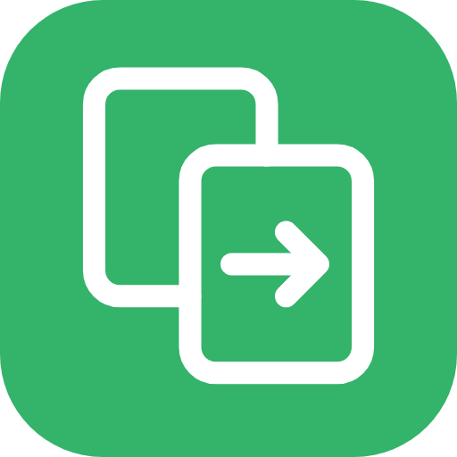

<p align="center">
  
</p>

<h1 align="center">KUDUCOPY</h1>

<p align="center">Fast, reliable file copying for Windows, built on Windows' own Robocopy.</p>

---

## Features

**Standard mode** — simple copy, cut and paste:

- **Copy or move** files and folders. Drag them in, use *Add files* / *Add folder*, or press **Ctrl+V** to paste what you copied in File Explorer (a cut becomes a move).
- **Right-click menu in File Explorer**: *Paste with KUDUCOPY*, plus *Copy to…* and *Move to…* with your favourite folders.
- **Clear progress**: overall percentage, speed, time left, the file being copied, and a list of every file with its status.
- **Pause, resume, skip a file, cancel.** A half-copied file is removed when you skip or cancel (never a file that was already there).
- **When a file already exists**: ask me, overwrite, replace if newer, skip, keep both (copies get a "(2)" name), or decide for each file.
- **Keep going** when a file can't be copied: it's retried, then listed at the end with the reason, and one click retries just the failed files.
- **Verify copies** (off by default): compares MD5, SHA-1, SHA-256 or CRC32 checksums after copying, and can save them to a checksum file. When moving with verify on, originals are only removed after their copies check out.
- **Queue**: jobs to the same drive wait their turn; jobs to different drives run at the same time.
- **Favourite folders**, **History** with failed files and logs, and **when finished**: close, play a sound, sleep or shut down.
- **Preview** before copying: see which files are new, which will be replaced and why, which are skipped or kept as copies, and (with `/MIR` or `/PURGE` in Advanced mode) which files would be deleted. Nothing is copied until you press Start.
- **Free space check** before copying, **light and dark mode**, and an **update check**.

**Advanced mode** — every Robocopy option:

- All of Robocopy's options in groups (copy, files to include or skip, retry, speed and threads, logging, monitoring), each with a plain-English description.
- Only the options your Windows version supports are shown (read from `robocopy /?`).
- A live Robocopy command you can copy, an *Extra options* box, and Robocopy job files (`.rcj`) to load and save.
- Options that need administrator rights are marked, and KUDUCOPY offers to restart as administrator. Options that delete files (`/MIR`, `/PURGE`) are marked and ask before running.

## How it works

KUDUCOPY runs `robocopy.exe`, which is part of Windows, to do the copying. First it lists what will be copied (Robocopy's list-only mode), asks about files that already exist, then runs Robocopy and shows its progress. After copying it checks that every file arrived, and verifies checksums if you switched that on. "Keep both" and per-file choices are copied by KUDUCOPY itself, because Robocopy can't rename files.

## Download

Get the latest version from the [Releases page](https://github.com/azeembukhariprivate/kuducopy/releases/latest):

- `KUDUCOPY-x.y.z-setup.exe`: installs for your user account, adds a Start menu entry and (optionally) the right-click menu.
- `KUDUCOPY-x.y.z-portable.zip`: unzip anywhere and run `KUDUCOPY.exe`.

Requires Windows 10 or 11. The .NET Framework 4.8 it uses is already part of Windows.

Windows SmartScreen may warn about a new app from an unknown publisher. Choose **More info → Run anyway**.

## No administrator rights needed

KUDUCOPY runs as a normal user. Settings and the right-click menu are stored for your Windows account only. A few Advanced options (backup mode `/B`, copying owner or auditing information) need administrator rights; KUDUCOPY tells you and offers to restart as administrator.

On Windows 11 the right-click entries are under **Show more options**.

## Command line

```
KUDUCOPY.exe [files or folders]                 open with these to copy
KUDUCOPY.exe --paste "D:\Folder"                paste what was copied or cut in File Explorer
KUDUCOPY.exe --copy-to "D:\Backup" files…       copy straight to a folder
KUDUCOPY.exe --move-to "D:\Backup" files…       move straight to a folder
```

## Privacy

Everything stays on your computer. History and logs are in `%LOCALAPPDATA%\KUDUCOPY`, settings in `HKEY_CURRENT_USER\Software\KUDUCOPY`. KUDUCOPY only goes online to check GitHub for a newer version, which you can turn off in Settings.

## Build from source

You need the [.NET SDK](https://dotnet.microsoft.com/download) (8 or later). The app builds and runs on Windows; the core tests run anywhere.

```
git clone https://github.com/azeembukhariprivate/kuducopy.git
cd kuducopy
dotnet run --project tests/KUDUCOPY.Tests
dotnet build src/KUDUCOPY/KUDUCOPY.csproj -c Release -o out/KUDUCOPY
out\KUDUCOPY\KUDUCOPY.exe --self-test
```

`--self-test` makes real copies with Robocopy in a temporary folder (conflicts, keep both, move, verify, a locked file and retry, advanced options, cancel, preview), opens every window in both themes, writes `self-test.log` and exits. To build the installer, install [Inno Setup 6](https://jrsoftware.org/isinfo.php) and compile `installer/KUDUCOPY.iss`.

## Publishing a new version

1. Change `<Version>` in `src/KUDUCOPY/KUDUCOPY.csproj`.
2. Commit, then create and push a tag with the same number:
   ```
   git tag v1.0.1
   git push origin v1.0.1
   ```
3. GitHub Actions tests and builds the app, and publishes the installer and portable zip on the Releases page.

## License

KUDUCOPY is free and open source software by Azeem Bukhari, released under the [MIT License](LICENSE).

KUDUCOPY uses Robocopy, which is part of Windows and is not included with KUDUCOPY. KUDUCOPY is not affiliated with, sponsored or endorsed by Microsoft. Windows and Robocopy are names of Microsoft Corporation. See [THIRD-PARTY-NOTICES.txt](THIRD-PARTY-NOTICES.txt).
